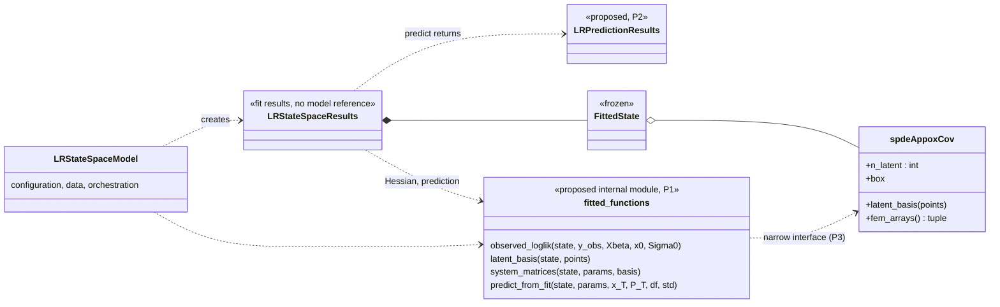

# geossm — Architecture decisions (Section B: UML and class responsibilities)

Status: **plan approved (2026-10-26), implemented one item at a time on branch `refactor`.** See the status column
of the table below.
Basis: the code at `091a5db` (merged into `develop` as `ed964cf`), drawn in [class_diagram.mmd](class_diagram.mmd)
(as implemented) and [pipeline.mmd](pipeline.mmd). The audit's local notes (`docs/design_audit/`, not tracked) hold
the detailed inventory and the findings `Fxx` referenced here. Constraints for every item: statistical semantics
unchanged (likelihood, EM updates, inference, prediction formulas), public API behaviour unchanged unless a decision
below says otherwise, and each step verified by the existing suite plus bit-identical Agrimonia results.

## Principal design decisions already in the code (keep)

1. **Pure kernels, stateful orchestrators.** Filtering, smoothing, sufficient statistics, prediction and the M-step
   are module-level JIT functions; classes orchestrate. This is the right split (B10) and the base for every proposal.
2. **Spatial discretisation is its own package** (`covmodel`: `FEMSolver`, `spdeAppoxCov`) and the user builds it
   (B9). Only the interface between it and the model is too wide (P3).
3. **Results are fit-time snapshots** (Section H: `FittedState`, read-only arrays). This makes it possible to remove
   the remaining results → model calls (P1).
4. **Data preparation is a separate builder/container pair** (`DesignMatricesBuilder` → `DesignMatrices`), reused for
   prediction so that stateful transforms keep their training statistics.

## Proposals, in recommended order

| ID | Proposal | B items | API impact | Risk | Effort | Status |
|---|---|---|---|---|---|---|
| P9 | Make the UML source-controlled | B17–B21 | none | none | S | **done** (`docs/architecture/`) |
| P4 | Remove duplicates and dead code | B3, B4 | none | low | S | next |
| P5 | Import hygiene: no package-root imports, no private names in `__all__` | B5, B12, B13 (F25) | `from geossm.ssm import *` no longer brings 4 private names | low | S | |
| P3 | Narrow spatial-basis interface on `spdeAppoxCov` | B9, B12 | additions only | low | S | |
| P1 | Results depend only on `FittedState`; `results.model` removed | B8, B12, B13 (F27) | **`results.model` removed** (D-B1) | medium | M | |
| P2 | `predict` returns a new `LRPredictionResults` | B8, B13 (F27, F46) | **`predict` return type changes** (D-B2) | medium | M | |
| P7 | Frozen `FitOptions`; `fit` does not persist `verbose` | B16 (F17) | mutating a `FitOptions` raises | low | S | |
| P6 | Split `LRStateSpaceModel` internally by responsibility | B2, B7, B10, B14 | none | medium | L | |
| P8 | Presentation and I/O out of numerical classes | B6 (F22) | none | low | M | |

Cross-references (not Section B): composition instead of `LRStateSpaceModel(StateSpaceModel)` (F26) → **Section C**
(C10); attribute catalogue, redundant derived state (B11), copy/sharing policy → **Section D**; logging policy
(F22) → **Section O**; pickling of `spdeAppoxCov` (F06) → **Section D**.

### P1 — Results stop calling the model (B8, B12, B13)

* **Now.** `LRStateSpaceResults._compute_hessian` calls `self.model._observed_logL(..., fitted_state=...)`;
  `compute_cov_params` calls `self.model._log`; `predict` calls `self.model.predict(df, self)`, which reads
  `results._fitted_state` and writes 10 result attributes. Everything these calls need is already in `FittedState` plus
  the results (params, smoothed states): `_observed_logL`, `_buildBasis_list`, `_buildH_dense`, `_buildRF_dense`,
  `_spde_mesh_arrays` and `_getPredictionDesignMatrix` use only those inputs (Section H passed them explicitly).
* **Proposal.** Move those helpers to an internal module (e.g. `geossm/stmodel/_fitted.py`, next to `FittedState`)
  as functions of `(fitted_state, ...)`: `observed_loglik(state, y_obs, Xbeta, x0, Sigma0)`,
  `latent_basis(state, points)`, `system_matrices(state, params, basis)`, `predict_from_fit(state, params, x_T,
  P_T, timestamps_hat, df, std)`. `LRStateSpaceModel` methods delegate to them (same names, same behaviour);
  `LRStateSpaceResults` calls them directly; the summary labels read from the model (`type`, `order`, `backend`)
  are snapshotted at construction.
* **`results.model` is removed (D-B1).** `FittedState` becomes the single, documented interface between a fitted
  model and everything done afterwards (inference, prediction, summaries): it gains the few fields the results still
  read from the model (model name, type/order, backend), and the functions above take it as their first argument. A
  future model type provides its own `FittedState`-compatible snapshot (a `typing.Protocol` only once a second model
  exists, Section C11).
* **Open point, to settle when P1 starts:** the base `StateSpaceResults.model` (plain `StateSpaceModel`) reads only
  summary labels; for consistency it would be replaced by the same snapshot fields.
* **Benefit.** One direction (model → results); the Hessian and prediction are testable without a model; no
  private cross-class calls.
* **Risk.** Code motion in the likelihood path. Mitigation: bit-identical Agrimonia llf/params/Hessian (CPU f32, f64),
  existing `TestFittedState`, `TestStandardErrors`, `TestMStepF40`, contract tests.

### P2 — Separate prediction results (B8, B13)

* **Now.** `results.predict(df)` → `model.predict(df, results)` stores `y_pred`, `Sigma_y_pred`, `points_pred`, ... on the
  fit results and returns them; a second call replaces the first, `back_transform` and `to_geo`/`to_poly` mix fit and
  prediction state (F46 was a symptom).
* **Decision (D-B2).** `results.predict(df, std=True)` (and `model.predict(df, results)`) return a new
  `LRPredictionResults` (prediction arrays, grid, CRS, per-variable views, `back_transform`, `to_geo`, and the change
  of support `to_poly`), built with P1's `predict_from_fit` from the fit results' `FittedState`. The fit results are no
  longer modified by prediction. No `get_prediction` method.
* **Compatibility (breaking change, to be released with a version bump and a changelog entry).** Code that reads
  `results.y_pred`, `results.Sigma_y_pred`, `results.*_pred*` or the prediction `*_back_list` after `predict` must use
  the returned object. Proposed transition: for one release, accessing those names on the fit results raises an
  `AttributeError` that says to use the object returned by `predict`. The fit results keep `to_geo` (fitted values)
  and `back_transform` (fitted values); their output shapes for the in-sample part are unchanged, and the exact
  return of `to_geo` (`{"hat", "pred"}` today) is settled when P2 starts.
* **Benefit.** Fit results become immutable after construction except for lazy caches; several predictions can
  coexist; `to_poly`/`back_transform` move to the object they belong to (B2 of `LRStateSpaceResults`).
* **Risk.** Two ways to predict during a transition. API decision D-B2 (keep both, or deprecate `predict`).

### P3 — Narrow spatial-basis interface (B9, B12)

* **Now.** The model reads `cov.fem_solver.mass`, `.stiff`, `.inner`, `.n_inner_points`, `.box` and calls the private
  `fem_solver._compute_basis`, then normalises rows and selects inner columns itself (`_buildBasis_list`,
  `_spde_mesh_arrays`, `setup`, initial values).
* **Proposal.** Public methods on `spdeAppoxCov` that state what the model needs:
  `n_latent` (inner nodes), `latent_basis(points)` (row-normalised basis on the inner nodes, the current
  `_buildBasis_list` body for one covariance object), `fem_arrays()` (mass, stiffness, inner-then-outer permutation,
  number of inner nodes, as used by `_spde_marginal_precision`), and `box`. The model uses only these.
* **Benefit.** `FEMSolver` becomes an implementation detail of `spdeAppoxCov`; another latent basis could implement
  the same four members (a `typing.Protocol` only if a second implementation appears — Section C, C11).
* **Risk.** Low; pure delegation. Test: basis and mesh arrays identical before/after.

### P4 — Duplicates and dead code (B3, B4)

* `_check_x64_for_dtype`: one definition (in `utils`), imported by `data_preparation` and `ssm`.
* `_minf` (unused NumPy copy of the `ks` objective) and the commented-out Nelder–Mead block: remove.
* SPDE marginal precision in SciPy and in JAX: keep both (sparse SciPy is cheap for Q; JAX is needed for gradients),
  and pin their equality with a test (they agree to ≤ 5e-16 relative in float64, Section B check).
* `LRStateSpaceModel._predict` (wrapper with timing) folded into `predict`; `StateSpaceModel.estimate` and
  `LRStateSpaceResults.predict` kept as documented conveniences.

### P5 — Import hygiene (B5, B12, B13; F25)

* `lrssm` imports `DesignMatricesBuilder` from `geossm.data_preparation`, `block_diag_3D` from `geossm.utils`, `Param`
  etc. from `geossm.stmodel.param` (no package-root or own-package imports).
* `ssm.__all__` lists only public names; internal modules import the private helpers from their defining module.
* `covmodels._validate_domain/_domain_hull`: move to `utils` (shared geometry helpers) or make them public in
  `covmodel` if users need them.

### P6 — Internal split of `LRStateSpaceModel` (B2, B7, B10, B14)

* **Now.** 2419 lines, 48 methods, five responsibilities (inventory B1).
* **Proposal.** Keep the public class and its methods; move the bodies into internal modules by responsibility:
  `stmodel/_design.py` (observation/prediction grids, design-matrix stacking), `stmodel/_fitted.py` (P1: basis,
  system matrices, likelihood, prediction), `stmodel/_em.py` (initial values, E/M steps, `ks` step, iteration log,
  stopping rule). The class keeps configuration, data and orchestration (`__init__`, `setup`, `fit`, `predict`,
  `sim`, `summary`).
* **Benefit.** Each piece is testable on its own; the class reads as a façade. Prepares Section C (composition
  instead of inheriting `StateSpaceModel` as the E-step channel).
* **Risk.** Large code motion; do after P1/P3 and in small commits, each bit-identical on Agrimonia.

### P7 — Frozen `FitOptions` (B16; F17)

* `@dataclass(frozen=True)`; the package never mutates it (verified). `fit` reads `options.verbose` for the call only
  instead of writing `self.verbose`. The `fit(options=None)` defaults (F17) are a Section F decision; P7 does not
  change them.
* **API.** User code that mutates a `FitOptions` instance would raise (`dataclasses.replace` is the alternative).

### P8 — Presentation and I/O (B6; F22)

* One verbosity/log helper in `utils` instead of `_log`/`print_info`/`_is_verbose` in four classes (pairs with the
  Section O logging policy).
* `FEMSolver.plot_mesh` → a plotting function (method kept as a wrapper); mesh statistics computed lazily instead of
  in the constructor (`stats=True`).
* `to_poly(path)`: file reading isolated in `_as_polygon_gdf` (already), documented as the only I/O.

### P9 — Source-controlled UML (B17–B21)

* Done: `class_diagram.mmd`, `pipeline.mmd` and this file are in `docs/architecture/` (D-B0). Rule (B21): the
  as-implemented diagrams are updated in the same commit as each item that changes the structure.

## Target structure after P1–P5 (proposal, not implemented)

## Decisions (2026-10-26)

| ID | Question | Decision |
|---|---|---|
| D-B0 | Where should the UML and this document live under version control? | `docs/architecture/` (tracked, outside the Sphinx tree); the rest of the audit stays local |
| D-B1 | After P1, keep `results.model`? | **Remove it.** Results reference only `FittedState`, which carries everything needed for prediction and inference and is the interface for future models |
| D-B2 | How is a prediction returned? | **`predict` returns `LRPredictionResults`** (with `to_poly`); no `get_prediction`. Breaking change with a transition error message (P2) |
| D-B3 | Order of work | P9 → P4 → P5 → P3 → P1 → P2 → P7 → P6 → P8, one item and one commit at a time, each approved |
