Model and estimation
======================

This page gives the statistical model fitted by
:class:`~geossm.stmodel.LRStateSpaceModel`, the estimation algorithm, and
the quantities reported after the fit, in the notation used by the code.

   The pipeline (source: ``docs/source/diagrams/pipeline.mmd``).

Notation
-----------

.. list-table::
   :widths: 25 75
   :header-rows: 1

   * - Symbol (attribute)
     - Meaning
   * - :math:`p` / :math:`T`
     - number of sites, stacked over the response variables (``block_p``
       separates them) / number of time steps
   * - :math:`y_t \in \mathbb{R}^p`
     - responses at time :math:`t` (``y_obs``; missing values are ``NaN``)
   * - :math:`X_t \in \mathbb{R}^{p \times b}`, :math:`\beta`
     - covariates (``Xbeta``, block-diagonal over the responses) and their
       coefficients (``beta``)
   * - :math:`x_t \in \mathbb{R}^q`
     - latent state: the latent fields at the inner mesh nodes, stacked
       over the :math:`q_\ell` latent factors (``block_q``)
   * - :math:`\Phi_{ij}`
     - FEM basis of latent factor :math:`j` at the sites of response
       :math:`i` (``latent_basis``)
   * - :math:`A`, :math:`s^2_e`, :math:`f`, :math:`\kappa`
     - loadings (``A``, responses × factors), measurement-error variances
       (``s2e``, one per response), AR coefficients (``f``) and SPDE scales
       (``ks``, one per factor)

The model
------------

For :math:`t = 1, \dots, T`,

.. math::

   \begin{aligned}
   y_t &= X_t \beta + H x_t + e_t, & e_t &\sim \mathcal{N}(0, R),\\
   x_t &= F x_{t-1} + \eta_t, & \eta_t &\sim \mathcal{N}(0, Q),\\
   x_0 &\sim \mathcal{N}(x_0, \Sigma_0),
   \end{aligned}

with independent errors and

.. math::

   \begin{aligned}
   H &= \bigl[A_{ij}\, \Phi_{ij}\bigr]_{ij}, &
   R &= \operatorname{diag}\bigl(s^2_{e,i}\ \text{on the sites of response } i\bigr),\\
   Q &= \operatorname{blockdiag}\bigl(\Lambda(\kappa_j)^{-1}\bigr), &
   F &= \operatorname{diag}\bigl(f_j\ \text{on the nodes of factor } j\bigr).
   \end{aligned}

So the latent term of site :math:`s` of response :math:`i` is
:math:`\sum_j A_{ij}\, \Phi_{ij}(s)\, x_{t,j}`: each response loads on every
latent factor (``A`` is :math:`n_\text{resp} \times q_\ell`).

The latent field: SPDE approximation
-------------------------------------------

Each latent factor is a Matérn field with smoothness :math:`\nu = 1` in two
dimensions, represented through the SPDE

.. math::

   (\kappa^2 - \Delta)\, x(s) = \mathcal{W}(s)

solved by linear finite elements on a triangular mesh, with Neumann
boundary conditions (:class:`~geossm.covmodel.SPDEApproxCov`). With
:math:`\tilde C` the lumped mass matrix and :math:`G` the stiffness matrix
(:class:`~geossm.covmodel.FEMSolver`), the precision of the field at the
mesh nodes is

.. math::

   \tilde\Lambda(\kappa) = \sigma^2(\kappa)\, K_\kappa \tilde C^{-1} K_\kappa,
   \qquad K_\kappa = \kappa^2 \tilde C + G, \qquad
   \sigma^2(\kappa) = \frac{\Gamma(\nu)}{\Gamma(\nu + 1)\, 4\pi \kappa^{2\nu}} = \frac{1}{4\pi\kappa^2},

scaled to unit marginal variance (the scale of the latent term is carried
by :math:`A`). The latent state uses the *inner* nodes (inside the latent
domain); the outer nodes, a buffer against boundary effects, are
integrated out by the Schur complement (``precision(marginal=True)``)

.. math::

   \Lambda(\kappa) = \tilde\Lambda_{11} - \tilde\Lambda_{12}\, \tilde\Lambda_{22}^{-1}\, \tilde\Lambda_{12}^\top.

The practical range is :math:`\sqrt{8\nu}/\kappa` (``emp_range``), in the
units of the data CRS: the FEM is planar in those units (see
:doc:`covariance_models`).

The basis row of a site is the FEM interpolant restricted to the inner
nodes and normalised to sum to 1. A site outside the latent domains, or
with an empty basis row, is *outside the support* of the latent field
(``in_support``): its observations are treated as missing in the fit.

Log-likelihood
-----------------

With :math:`o_t` the observed entries of :math:`y_t` (``NaN`` and
out-of-support entries are missing) and :math:`n = \sum_t |o_t|`
(``nobs``), the observed-data log-likelihood is

.. math::

   \begin{aligned}
   \ell(\theta) &= -\frac12 \sum_{t=1}^T \Bigl(\log\lvert S_t\rvert
   + v_t^\top S_t^{-1} v_t + \lvert o_t\rvert \log 2\pi\Bigr),\\
   v_t &= y_{t,o_t} - X_{t,o_t}\beta - H_{o_t} x_{t\mid t-1},
   \qquad S_t = H_{o_t} P_{t\mid t-1} H_{o_t}^\top + R_{o_t},
   \end{aligned}

computed by the Kalman filter without forming the :math:`p \times p`
matrix :math:`S_t`: with :math:`H_t` the rows of :math:`H` with the missing
rows set to zero,

.. math::

   \begin{aligned}
   M_t &= P_{t\mid t-1}^{-1} + H_t^\top R^{-1} H_t, &
   \lvert S_t\rvert &= \lvert M_t\rvert\, \lvert P_{t\mid t-1}\rvert\, \lvert R_{o_t}\rvert,\\
   P_{t\mid t} &= M_t^{-1}, & K_t &= M_t^{-1} H_t^\top R^{-1},
   \end{aligned}

and :math:`x_{t\mid t} = x_{t\mid t-1} + K_t v_t` (information form of the
update, symmetric positive definite by construction).

Estimation: the EM algorithm
-------------------------------

:meth:`~geossm.stmodel.LRStateSpaceModel.fit` maximises :math:`\ell` by
expectation-maximisation.

**E-step.** The Kalman filter and the Rauch-Tung-Striebel smoother give
:math:`\hat x_t = x_{t\mid T}`, :math:`P_t = P_{t\mid T}` and the lag-one
covariances, hence the sufficient statistics

.. math::

   S_{11} = \sum_{t=1}^T \mathbb{E}[x_t x_t^\top \mid y], \qquad
   S_{10} = \sum_{t=1}^T \mathbb{E}[x_t x_{t-1}^\top \mid y], \qquad
   S_{00} = \sum_{t=1}^T \mathbb{E}[x_{t-1} x_{t-1}^\top \mid y].

**M-step.** Each update maximises the expected complete-data
log-likelihood given the latest values of the others (an ECM algorithm, so
:math:`\ell` does not decrease). A parameter fixed in ``params0`` keeps its
value, and the later steps use it.

- AR coefficients, given the current :math:`\kappa`, for each factor
  :math:`j` (blocks of the matrices on its nodes):

  .. math::

     f_j = \frac{\operatorname{tr}\bigl(\Lambda_j\, S_{10,jj}\bigr)}{\operatorname{tr}\bigl(\Lambda_j\, S_{00,jj}\bigr)},
     \qquad \Lambda_j = \Lambda(\kappa_j).

- SPDE scales, given the new :math:`f`: with
  :math:`\Omega = S_{11} - S_{10} F^\top - F S_{10}^\top + F S_{00} F^\top`,

  .. math::

     \kappa = \arg\min_{\kappa > 0}\; \Bigl\{\operatorname{tr}\bigl(\Lambda(\kappa)\, \Omega\bigr) - T \log\lvert\Lambda(\kappa)\rvert\Bigr\},

  by L-BFGS-B over :math:`\log\kappa` with exact JAX gradients, until the
  gradient is below ``FitOptions.ks_tol`` times the objective.

- Measurement-error variances, from the E-step residuals
  :math:`r_t = y_t - X_t\beta - H\hat x_t` over the observed entries of
  response :math:`i`:

  .. math::

     s^2_{e,i} = \frac{1}{n_i} \sum_{t=1}^T \sum_{s \in o_{t,i}}
     \Bigl(r_{t,s}^2 + \bigl(H P_t H^\top\bigr)_{ss}\Bigr).

- Regression coefficients, with :math:`D_t` the diagonal selector of
  the observed entries:

  .. math::

     \beta = \Bigl(\sum_{t} X_t^\top D_t X_t\Bigr)^{-1} \sum_{t} X_t^\top D_t \bigl(y_t - H \hat x_t\bigr).

- Loadings, given the new :math:`\beta`, one row :math:`a_i` of :math:`A`
  per response: with :math:`u_{it} = y_{it} - X_{it}\beta`,

  .. math::

     \sum_k \Bigl(\sum_t \mathbb{E}\bigl[(\Phi_{ij} x_{t,j})^\top D_{it}\, \Phi_{ik} x_{t,k} \mid y\bigr]\Bigr) A_{ik}
     = \sum_t u_{it}^\top D_{it}\, \Phi_{ij}\, \hat x_{t,j}
     \quad \text{for every factor } j.

- Initial state: :math:`x_0 = \hat x_0`, :math:`\Sigma_0 = P_0`.

The algorithm stops when :math:`\lvert\ell_k - \ell_{k-1}\rvert / n <`
``tol_relat`` or after ``max_iter`` iterations (:class:`~geossm.stmodel.FitOptions`).
A final E-step evaluates :math:`\ell`, the states and the fitted values at
the returned parameters.

Inference
------------

:meth:`~geossm.stmodel.LRStateSpaceResults.compute_cov_params` computes the
Hessian of :math:`\ell` with respect to the free parameters (excluding
:math:`x_0, \Sigma_0`) by automatic differentiation, one Hessian-vector
product per free parameter (for its memory, see
:doc:`jax_configuration`), and

.. math::

   \widehat{\operatorname{Cov}}(\hat\theta) = -\bigl(\nabla^2 \ell(\hat\theta)\bigr)^{-1}.

This is a covariance matrix only at a maximum of :math:`\ell`; it is not
checked. Confidence intervals (``conf_int``) use the Student-:math:`t`
quantile :math:`c` with ``df_resid`` degrees of freedom. They are Wald
intervals :math:`\hat\theta \pm c\, \mathrm{se}`, except for the bounded
parameters, which are mapped from a transformed scale:

.. math::

   s^2_e, \kappa:\ \ \hat\theta\, \exp\bigl(\pm c\, \mathrm{se}/\hat\theta\bigr),
   \qquad
   f:\ \ \tanh\Bigl(\operatorname{atanh}\hat f \pm c\, \frac{\mathrm{se}}{1 - \hat f^2}\Bigr).

The information criteria are
:math:`\mathrm{AIC} = 2k - 2\ell(\hat\theta)` and
:math:`\mathrm{BIC} = k \log n - 2\ell(\hat\theta)`, with :math:`k` the
number of free parameters (``n_params``).

Prediction
-------------

At new sites and times within the training period
(:meth:`~geossm.stmodel.LRStateSpaceResults.get_prediction`), with the
basis :math:`H^\ast` and covariates :math:`X_t^\ast` of the new sites,

.. math::

   \hat y_t^\ast = X_t^\ast \hat\beta + H^\ast \hat x_t, \qquad
   \operatorname{Cov}(\hat y_t^\ast) = H^\ast P_t H^{\ast\top},

the smoothed (plug-in) mean and covariance of the latent signal. The
measurement error is not included: for a prediction interval of a new
observation add :math:`s^2_e`. Sites outside the latent support get
:math:`X_t^\ast\hat\beta` and variance 0 (``in_support``).

For a transformed response :math:`g(y)` (e.g. ``np.log(y)``),
``back_transform(g_inv)`` applies the delta method with :math:`h = g^{-1}`:

.. math::

   \mathbb{E}[h(Y)] \approx h(\mu) + \tfrac12 h''(\mu)\, \sigma^2, \qquad
   \operatorname{Cov}\bigl(h(Y_s), h(Y_{s'})\bigr) \approx h'(\mu_s)\, \Sigma_{ss'}\, h'(\mu_{s'}).

``to_poly`` averages the predictions over polygons (change of support):
with :math:`W` the matrix averaging the in-support prediction sites of
each polygon,

.. math::

   \hat y^{\text{poly}}_t = W \hat y_t, \qquad
   \operatorname{sd}\bigl(\hat y^{\text{poly}}_t\bigr) = \sqrt{\operatorname{diag}\bigl(W \Sigma_t W^\top\bigr)}.
